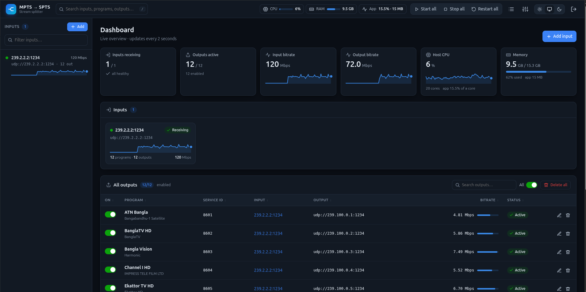

# mpts2spts

Splits multicast MPTS inputs into single-program SPTS outputs (UDP or RTP), managed from a web UI. It ships as one Go binary with the UI embedded and keeps its configuration in SQLite.



## Install (release packages)

Ready-made packages for **amd64** and **arm64** are on the [Releases page](https://github.com/supermediatech/demux-mpts-spts/releases). Pushing a `v*` tag builds and publishes them through GitHub Actions (`.github/workflows/release.yml`).

Build the packages with `make dist` (or `make dist VERSION=1.2.0`). That produces, in `dist/`:

| File | For |
|---|---|
| `mpts2spts_<ver>_amd64.deb` | Debian / Ubuntu |
| `mpts2spts_<ver>_amd64.tar.gz` | any x86-64 Linux with systemd |
| `mpts2spts_<ver>_amd64.sha256` | checksums |

The binary is fully static, so it has no runtime dependencies and needs no libc version match.

**Debian/Ubuntu**
```sh
sudo apt install ./mpts2spts_1.0.0_amd64.deb
```

**Other distros**
```sh
tar xzf mpts2spts_1.0.0_amd64.tar.gz && cd mpts2spts_1.0.0_amd64
sudo ./install.sh
```

Either way, the installer creates the `mpts2spts` system user, installs the systemd service, and enables and starts it. It then prints the web URL and a randomly generated `admin` password.

| Path | What |
|---|---|
| `/opt/mpts2spts/mpts2spts` | binary |
| `/etc/mpts2spts/mpts2spts.env` | login (`USERNAME`, `PASSWORD`) and `LISTEN` address |
| `/var/lib/mpts2spts/mpts2spts.db` | configuration database |

After editing the env file, run `sudo systemctl restart mpts2spts`. Logs: `journalctl -u mpts2spts -f`.

Upgrading means installing a newer package over the old one; the configuration and database are kept. To remove it, run `sudo apt remove mpts2spts` (keeps data) or `sudo apt purge mpts2spts` (deletes data). For a tarball install, use `sudo /opt/mpts2spts/uninstall.sh [--purge]`.

The service runs unprivileged with only `CAP_NET_RAW` (interface binding, Discover), `CAP_NET_ADMIN` (large socket buffers) and `CAP_NET_BIND_SERVICE`.

## Development

```sh
make            # static ./mpts2spts
./mpts2spts -listen :8080 -db mpts2spts.db -env .env
```

`.env` holds the web login:

```
USERNAME=admin
PASSWORD=change-me
```

Flags: `-listen` (web address), `-db` (SQLite file), `-env` (credentials file), `-version`, `-pprof` (debug profiler address, off by default). To use Discover when running by hand, run `sudo setcap cap_net_raw,cap_net_admin+ep mpts2spts` again after each build.

## Releasing a new version

A release is a git tag. The version is never written in a source file: the build takes it from the tag (`-X main.version=…`), and it appears in `mpts2spts -version`, the web UI footer and the package names.

1. Pick the next version with [semantic versioning](https://semver.org): `vMAJOR.MINOR.PATCH`. Bump PATCH for fixes only, MINOR for new features, MAJOR for changes that break existing setups. `git tag --sort=-v:refname | head -1` shows the latest one.
2. Make sure `main` holds everything you want to ship, is pushed, and the `ci` workflow passed on it:
   ```sh
   git checkout main && git pull
   git status            # must be clean
   git push origin main
   ```
3. Create an annotated tag and push it:
   ```sh
   git tag -a v1.9.0 -m "v1.9.0: short summary of the changes"
   git push origin v1.9.0
   ```
4. Pushing the tag starts the `release` workflow ([.github/workflows/release.yml](.github/workflows/release.yml)). It builds the `.deb` and `.tar.gz` for amd64 and arm64, combines the checksums into `SHA256SUMS`, and publishes a GitHub Release with install instructions and release notes generated from the commits since the previous tag. Follow it on the repository's **Actions** tab. It takes a few minutes.
5. Check the release on the [Releases page](https://github.com/supermediatech/demux-mpts-spts/releases). Edit its notes there if you want to highlight anything.

A tag with a hyphen, such as `v2.0.0-rc1`, is published as a **pre-release**, so you can test a build before the real release.

**If the release workflow fails**, fix the problem on `main`, then move the tag to the fixed commit and push it again. Delete any half-made release on GitHub first.
```sh
git tag -d v1.9.0 && git push origin :refs/tags/v1.9.0
git tag -a v1.9.0 -m "v1.9.0: …" && git push origin v1.9.0
```
Only do this before anyone has installed the release. Once it is out, publish a new PATCH version instead.

**Building release packages locally** (without publishing): `make dist VERSION=1.9.0` writes the amd64 packages to `dist/`. For arm64, install `gcc-aarch64-linux-gnu` and run `make dist VERSION=1.9.0 ARCH=arm64 CC=aarch64-linux-gnu-gcc`. `make dist` also needs `fakeroot`.

## Usage

- **Inputs**: there are four ways to add them.
  - **Discover all** (default): pick an interface, or all interfaces, and the app listens for a few seconds. It finds every TS stream on any IP and any port: unicast, multicast, UDP or RTP. The results list every channel (program name first, then SID, type, streams, source stream and bitrate). Tick the channels you want and press **Add**: only the streams carrying them become inputs, and each input keeps only the ticked channels. **Skip audio-only** (on by default) hides radio channels and never adds them. **Scan range** results use the same channel list. This needs `CAP_NET_RAW` (`sudo setcap cap_net_raw+ep mpts2spts`, or run as root; the systemd unit already grants it). It can only see multicast the switch actually delivers; behind IGMP snooping, use **Scan range**.
  - **By interface**: pick a local address once, then enter any number of groups, one per line or comma separated. Ranges are accepted (`239.2.2.1-239.2.2.20` or `239.2.2.1-20`), and `:port` on an entry overrides the default port. All of them are added in one step, and groups that already exist are skipped.
  - **Manual URL**: type a full URL.
  - **Scan**: joins a range of groups on one interface and lists the ones that carry TS. Add them one by one, or all at once with **Add all**.

  URL form:
  `udp://239.2.2.2:1234?localaddr=192.168.10.10` (optionally `&sources=<ip>` for SSM). `rtp://` inputs are accepted too, and an RTP header is detected and stripped automatically.
- **Kept channels**: the dashboard, program lists, All programs and search only show the channels kept on each input. Use **Channels** on an input's Programs card to change the selection. Ticking every channel keeps all of them, including ones the stream adds later. Backups include the selection.
- **Pages** (sidebar): **Dashboard** shows overall health, live totals, the input/output throughput chart, CPU and memory, and a **Needs attention** list of inputs without signal and failing outputs. **All inputs** is a sortable table of every input with its status, kept channels and outputs. **All outputs** lists every output with enable/disable, edit and delete. Long lists show 100 rows per page; the sidebar lists the first 150 inputs (use its filter or **Show more** for the rest).
- **Links**: the page address follows what you are viewing (`#/`, `#/inputs`, `#/programs`, `#/outputs`, `#/input/<id>`, `#/search/<text>`), so refresh, back/forward and bookmarks return to the same view.
- **Programs**: each running input lists its services (name and provider from the SDT, plus streams and bitrate). Tick several and use **Create outputs**, or use **+ Output** on one row.
- **All programs** (sidebar): one table with every program from every enabled input. Filter by input, search, or show only programs without outputs. Tick programs across any inputs and use **Create outputs** to make them all at once with auto addresses, or use **+ Output** on one row.
- **Preview**: the ▶ button on any program row plays that program in the browser, so you can check what is on it. The server runs ffmpeg to make a low-latency HLS stream (H.264 + AAC, up to 480p, 1-second fMP4 segments) in a temporary folder. The preview stops and the folder is deleted when you close the player, when the browser stops watching for 20 seconds, or when the app stops. Up to 4 previews run at once. This needs `ffmpeg` on the server (`sudo apt install ffmpeg`). The player is [hls.js](https://github.com/video-dev/hls.js) (Apache-2.0), built into the binary.
- **Outputs**: UDP or RTP, with `localaddr` choosing the egress interface. Leave the address empty to allocate the next free `ip:port` from the pool in **Settings**, or type one. **Auto increment** in Settings chooses how the pool grows: by **IP address** (239.100.0.1:1234, 239.100.0.2:1234, …) or by **port** (239.100.0.1:1234, 239.100.0.1:1235, …). Addresses already in use are skipped. Service ID and TS ID are optional overrides.
- **Playlist** (list icon in the top bar): opens a dialog that groups the enabled outputs by the interface they are sent from (`localaddr`, or the default route). For each group, choose whether to include it and which `localaddr` its playlist entries carry, which is the interface the receiving player joins on. Keep it, type the player's address, or clear it to leave it out, then **Download**. Over the API, `GET /api/playlist.m3u` with no parameters lists every enabled output without `localaddr`. Add `if=<output localaddr>:<playlist localaddr>` once per group to include (empty means none, for example `if=:10.0.0.5` for default-route outputs), and `ex=<output localaddr>` to leave a group out.
- **Start all / Stop all** (top bar) enable or disable every input. This is saved, so it persists across restarts. **Restart all** reopens every socket and leaves the configuration unchanged.
- **Delete several at once**: tick inputs on **All inputs** (or in the sidebar; both share one selection) or outputs on any outputs table. The header checkbox selects everything the current search shows, across pages. Then use **Delete selected**. Every delete first shows what will go, how many items are running and how many outputs go with the inputs. Running inputs and outputs are stopped first, then deleted. **Delete all** in search results removes the matching inputs.
- On each outputs table, the **All** toggle enables or disables every output shown (it acts on the current search results).
- **No duplicates**: an input that receives a stream another input already receives is refused. It counts as the same stream when the group:port (and SSM source) match on the same interface, whether written as `udp://` or `rtp://`; an input without an interface overlaps every interface. Different explicit interfaces are allowed, for main and backup networks that carry the same group. Discover, Scan and **By interface** show such streams as already added and skip them. Each program gets at most one output per egress interface (`localaddr`; the default route counts as one interface), so a program can go out on several networks but never twice on the same one. In **Create outputs**, programs that already have an output on the chosen interface cannot be ticked. An output address cannot be used twice, and an output may not send to an address an input receives. Restoring an older backup that contains such duplicates keeps the first of each and reports how many were skipped.
- **Backup & restore** (in **Settings**): **Download backup** saves every input, output and setting to a JSON file. **Restore from file…** loads one back and replaces the current inputs and outputs. The file is checked before anything changes, so a bad file leaves the configuration as it was. Over the API: `GET /api/backup` and `POST /api/restore` with the file as the request body.
- **Search**: the box in the top bar searches inputs, programs and outputs together. Each table also has its own search box, and the sidebar has an input filter.
- The top bar shows host CPU, host RAM and the app's own CPU (% of one core) and memory. The dashboard adds live totals, a throughput chart and a CPU trend; hover over a chart to read its values.
- **Tables sort** when you click a column header; click it again to reverse the order. Each browser remembers the order you chose.
- **Refresh interval** (in **Settings**): how often the page reloads status, 1 to 60 seconds, default 5. With hundreds of inputs, 2 to 5 seconds is a good choice. A browser tab in the background does not refresh.
- **Copy**: click any address (inputs, outputs, discovered streams, senders) to copy it. This also works over plain `http://`.
- **Theme**: Light, Auto (follows the OS) or Dark. Use the switch in the top bar, in Settings or on the sign-in page; each browser remembers its choice.

## Automatic recovery

Every input has its own watchdog, so nobody has to restart anything by hand.

- **Source goes silent:** after 3 s the input shows *No signal*. After 5 s it closes the socket and re-joins from scratch: a fresh IGMP join, and PAT/PMT/SDT are read again. It retries after 1 s, 2 s, 4 s and so on, up to every 30 s, until the source returns. The backoff resets as soon as data flows again. Outputs resume by themselves, with the same addresses, service IDs and names.
- **Input can't be opened** (e.g. the interface is down or its IP was removed): it retries with the same backoff.
- **Output socket breaks** (e.g. the egress interface went away): it is reopened automatically.
- **Internal error in one input:** only that input restarts. The other streams and the web UI keep running. If the whole process ever dies, systemd restarts it within 2 s (`Restart=always`).
- **What you see:** the UI shows how long a source has been down, the current reconnect attempt, and the total number of automatic reconnects. The log records each event:
  ```
  input 3 udp://239.2.2.2:1234: signal lost
  input 3 udp://239.2.2.2:1234: no signal; reconnecting in 1s (attempt 1)
  input 3 udp://239.2.2.2:1234: signal restored after 16s
  ```
  Use `journalctl -u mpts2spts -f` to follow the log.

## Stable output across restarts

Each output's identity is stored in SQLite when you create it: service ID, TS ID, ONID, program name, provider, service type and destination. On every start the app rebuilds PAT and SDT from these stored values. Version numbers are derived from the content, so the PSI comes out byte-identical after a restart. The PMT is the source PMT with only `program_number` changed, and ES PIDs pass through unchanged. If the source later renames a service, the output keeps its stored name until you edit it.

## Performance

There is one OS thread per input. It joins the MPTS once and reads with blocking `recvmmsg` (64 datagrams per call), paced by 2 ms when the socket buffer is shallow. Each TS packet costs one PID-table lookup plus a 188-byte copy for each output that wants it. Output goes out through `sendmmsg`, batched per interface. There are no per-packet allocations.

Measured on the test stream (126 Mbps MPTS with 12 programs and 3 outputs): about 9.5% of one core and 11 MB RSS.
