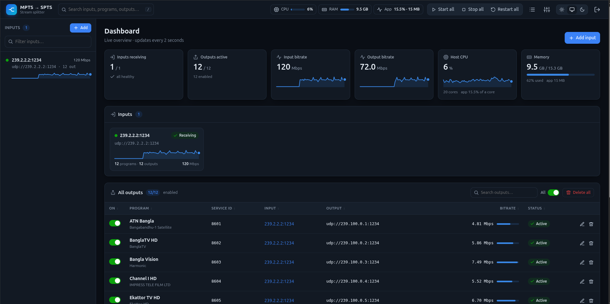

# mpts2spts

Splits multicast MPTS inputs into single-program SPTS outputs (UDP or RTP), managed from a web UI. It ships as one Go binary with the UI embedded and keeps its configuration in SQLite.



## Install (release packages)

Ready-made packages for **amd64** and **arm64** are on the [Releases page](https://github.com/supermediatech/demux-mpts-spts/releases). Pushing a `v*` tag builds and publishes them through GitHub Actions (`.github/workflows/release.yml`).

Build the packages with `make dist` (or `make dist VERSION=1.2.0`). That produces, in `dist/`:

| File | For |
|---|---|
| `mpts2spts_<ver>_amd64.deb` | Debian / Ubuntu |
| `mpts2spts_<ver>_amd64.tar.gz` | any x86-64 Linux with systemd |
| `mpts2spts_<ver>_amd64.sha256` | checksums |

The binary is fully static, so it has no runtime dependencies and needs no libc version match.

**Debian/Ubuntu**
```sh
sudo apt install ./mpts2spts_1.0.0_amd64.deb
```

**Other distros**
```sh
tar xzf mpts2spts_1.0.0_amd64.tar.gz && cd mpts2spts_1.0.0_amd64
sudo ./install.sh
```

Either way, the installer creates the `mpts2spts` system user, installs the systemd service, and enables and starts it. It then prints the web URL and a randomly generated `admin` password.

| Path | What |
|---|---|
| `/opt/mpts2spts/mpts2spts` | binary |
| `/etc/mpts2spts/mpts2spts.env` | login (`USERNAME`, `PASSWORD`) and `LISTEN` address |
| `/var/lib/mpts2spts/mpts2spts.db` | configuration database |

After editing the env file, run `sudo systemctl restart mpts2spts`. Logs: `journalctl -u mpts2spts -f`.

Upgrading means installing a newer package over the old one; the configuration and database are kept. To remove it, run `sudo apt remove mpts2spts` (keeps data) or `sudo apt purge mpts2spts` (deletes data). For a tarball install, use `sudo /opt/mpts2spts/uninstall.sh [--purge]`.

The service runs unprivileged with only `CAP_NET_RAW` (interface binding, Discover), `CAP_NET_ADMIN` (large socket buffers) and `CAP_NET_BIND_SERVICE`.

## Development

```sh
make            # static ./mpts2spts
./mpts2spts -listen :8080 -db mpts2spts.db -env .env
```

`.env` holds the web login:

```
USERNAME=admin
PASSWORD=change-me
```

Flags: `-listen` (web address), `-db` (SQLite file), `-env` (credentials file), `-version`, `-pprof` (debug profiler address, off by default). To use Discover when running by hand, run `sudo setcap cap_net_raw,cap_net_admin+ep mpts2spts` again after each build.

## Usage

- **Inputs**: there are four ways to add them.
  - **Discover all** (default): pick an interface, or all interfaces, and the app listens for a few seconds. It finds every TS stream on any IP and any port: unicast, multicast, UDP or RTP. Each result shows the sender, bitrate and programs, and you add them one by one or with **Add all**. This needs `CAP_NET_RAW` (`sudo setcap cap_net_raw+ep mpts2spts`, or run as root; the systemd unit already grants it). It can only see multicast the switch actually delivers; behind IGMP snooping, use **Scan range**.
  - **By interface**: pick a local address once, then enter any number of groups, one per line or comma separated. Ranges are accepted (`239.2.2.1-239.2.2.20` or `239.2.2.1-20`), and `:port` on an entry overrides the default port. All of them are added in one step, and groups that already exist are skipped.
  - **Manual URL**: type a full URL.
  - **Scan**: joins a range of groups on one interface and lists the ones that carry TS. Add them one by one, or all at once with **Add all**.

  URL form:
  `udp://239.2.2.2:1234?localaddr=192.168.10.10` (optionally `&sources=<ip>` for SSM). `rtp://` inputs are accepted too, and an RTP header is detected and stripped automatically.
- **Programs**: each running input lists its services (name and provider from the SDT, plus streams and bitrate). Tick several and use **Create outputs**, or use **+ Output** on one row.
- **Outputs**: UDP or RTP, with `localaddr` choosing the egress interface. Leave the address empty to allocate the next free `ip:port` from the pool in **Settings**, or type one. Service ID and TS ID are optional overrides.
- **Playlist**: downloads an M3U of every enabled output.
- **Start all / Stop all** (top bar) enable or disable every input. This is saved, so it persists across restarts. **Restart all** reopens every socket and leaves the configuration unchanged.
- On each outputs table, the **All** toggle enables or disables every output shown, and **Delete all** removes every output shown. Both act on the current search results, so you can search first and then act on a subset.
- **Search**: the box in the top bar searches inputs, programs and outputs together. Each table also has its own search box, and the sidebar has an input filter.
- The top bar shows host CPU, host RAM and the app's own CPU (% of one core) and memory. The dashboard adds live KPI tiles and bitrate/CPU sparklines; hover over a sparkline to read its values.
- **Tables sort** when you click a column header; click it again to reverse the order. Each browser remembers the order you chose.
- **Theme**: Light, Auto (follows the OS) or Dark. Use the switch in the top bar, in Settings or on the sign-in page; each browser remembers its choice.

## Automatic recovery

Every input has its own watchdog, so nobody has to restart anything by hand.

- **Source goes silent:** after 3 s the input shows *No signal*. After 5 s it closes the socket and re-joins from scratch: a fresh IGMP join, and PAT/PMT/SDT are read again. It retries after 1 s, 2 s, 4 s and so on, up to every 30 s, until the source returns. The backoff resets as soon as data flows again. Outputs resume by themselves, with the same addresses, service IDs and names.
- **Input can't be opened** (e.g. the interface is down or its IP was removed): it retries with the same backoff.
- **Output socket breaks** (e.g. the egress interface went away): it is reopened automatically.
- **Internal error in one input:** only that input restarts. The other streams and the web UI keep running. If the whole process ever dies, systemd restarts it within 2 s (`Restart=always`).
- **What you see:** the UI shows how long a source has been down, the current reconnect attempt, and the total number of automatic reconnects. The log records each event:
  ```
  input 3 udp://239.2.2.2:1234: signal lost
  input 3 udp://239.2.2.2:1234: no signal; reconnecting in 1s (attempt 1)
  input 3 udp://239.2.2.2:1234: signal restored after 16s
  ```
  Use `journalctl -u mpts2spts -f` to follow the log.

## Stable output across restarts

Each output's identity is stored in SQLite when you create it: service ID, TS ID, ONID, program name, provider, service type and destination. On every start the app rebuilds PAT and SDT from these stored values. Version numbers are derived from the content, so the PSI comes out byte-identical after a restart. The PMT is the source PMT with only `program_number` changed, and ES PIDs pass through unchanged. If the source later renames a service, the output keeps its stored name until you edit it.

## Performance

There is one OS thread per input. It joins the MPTS once and reads with blocking `recvmmsg` (64 datagrams per call), paced by 2 ms when the socket buffer is shallow. Each TS packet costs one PID-table lookup plus a 188-byte copy for each output that wants it. Output goes out through `sendmmsg`, batched per interface. There are no per-packet allocations.

Measured on the test stream (126 Mbps MPTS with 12 programs and 3 outputs): about 9.5% of one core and 11 MB RSS.
